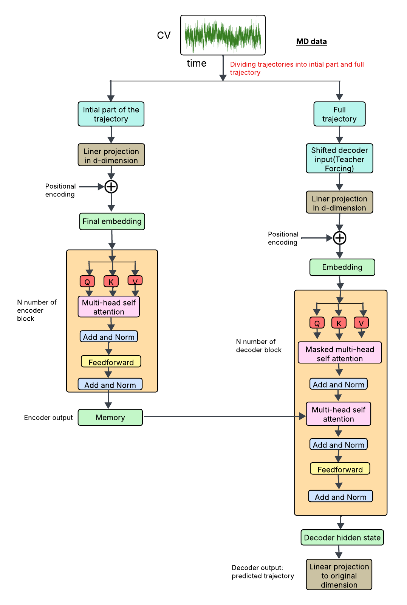

# MDgen

This repository is the official implementation of the paper **"Enhanced Transformer-Based Sampling for
Long-Range Molecular Dynamics Trajectory
Generation"**.

<p align="center">
  
</p>

A Transformer-based autoregressive framework for learning and generating Molecular Dynamics (MD) trajectories. This project models long-range temporal dependencies in MD simulations and generates future trajectory segments conditioned on an initial fraction of the sequence.

The framework currently supports three systems:

1. Cytochrome P450 (P450)

2. Toy 3-Well Potential System

3. α-Synuclein (Asyn)

## Requirements

This project was developed using:

Python ≥ 3.8

PyTorch ≥ 1.13

NumPy

Matplotlib

It is recommended to use a virtual environment (e.g., Conda).. A virtual environment manager such as [Conda](https://conda.io/projects/conda/en/latest/user-guide/getting-started.html) is recommended.

## Creat environment:
conda create -n mdtraj python=3.8

conda activate mdtraj

pip install torch numpy matplotlib

## Project overview
Each system directory contains:

Raw MD trajectory data

data.py → synthetic data generation (noise augmentation)

trans1.py → Transformer model training

inference1.py or inference2.py → trajectory generation

The workflow is similar across systems, with minor differences in file names and data formats.

## 1. P450 System
Raw Data (distance0.xvg, distance1.xvg, distance2.xvg) contain MD trajectory distance measurements. These training data can be found in 'data'.

## Workflow (P450)
Step 1: data.py loads MD trajectories, adds small Gaussian noise and produces augmented synthetic trajectories data for training. 

Step 2: trans1.py trains our autoregressive Transformer model, which uses sliding-window sequence learning to learn long-range trajectory dependencies.

Step 3: inference2.py generates future trajectory segments autoregressively, allowing modification of input conditioning percentage (e.g., first 10%)

## 2 and 3. Toy 3-Well System and α-Synuclein (Asyn) System

## Data augmentation and Training
Raw Data (threewell.npy, asyn.npy) training data can be found in 'data'.

To generate synthetic data, run:

```
python data.py
```
To train, run:

```
python trans1.py
```
To do inference, run:

```
python inference1.py
```

## Evaluation (Kinetic Analysis)
We have compared how the free energy surface, ITS, and CK-test are from generated data compared to training data for each system.
To get FES, go analysis fodler and run 
```
python FES.py
```
To get MSM, go analysis fodler and run 
```
python build_msm.py
```
To get ITS, go analysis fodler and run 
```
python build_its_pyemma.py
```
To get CK-test, go analysis fodler and run 
```

To get spectral analysis, go analysis fodler and run 
```
spectral_analysis.py
```
python build_cktest_pyemma.py
```
To get PCCA, go analysis fodler and run 
```
python ASYN_PCCA_plot.py.py
```
To get MFPT, go analysis fodler and run 
```
mfpt.py
```

<!-- LICENSE -->
## License

Distributed under the MIT License. See `LICENSE` for more information.

<p align="right">(<a href="#top">back to top</a>)</p>


<!-- CONTACT -->
## Contact

Name - Soham Choudhuri - choudhurisoham@gmail.com

Project Link: [https://github.com/soham2-4/MDgen/tree/main)

<p align="right">(<a href="#top">back to top</a>)</p>
